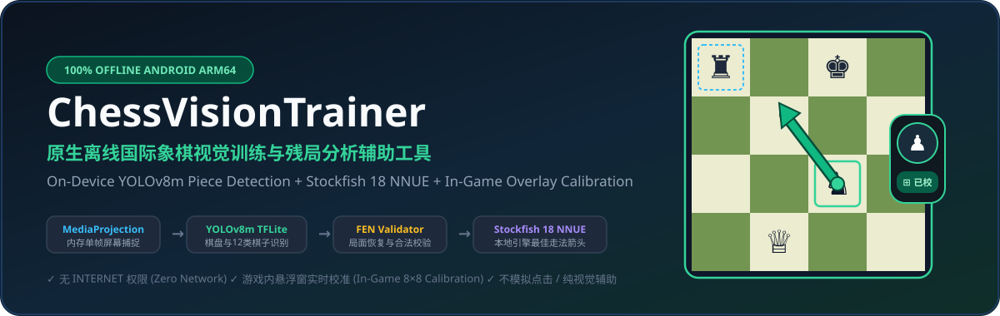
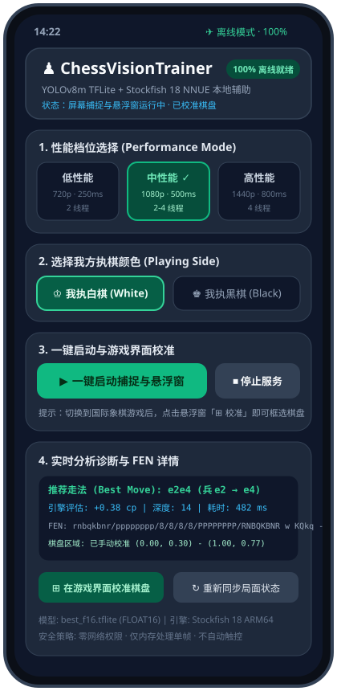
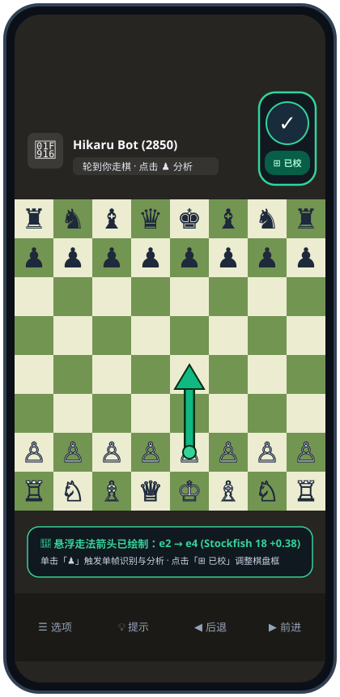
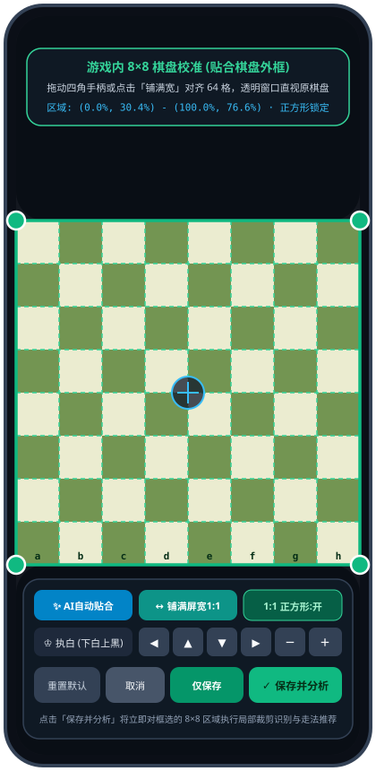

<div align="center">



# ♟ ChessVisionTrainer

**100% 离线原生 Android 国际象棋视觉训练与残局分析辅助工具**  
**100% Offline Native Android Chess Vision Trainer & Endgame Analysis Assistant**

[](#)
[](#)
[](#)
[](#)
[](#)

[**简体中文**](#-简体中文介绍) | [**English**](#-english-overview) | [**界面截图 / Screenshots**](#-界面截图--screenshots) | [**功能特性 / Features**](#-核心功能--key-features) | [**构建指南 / Build**](#-构建与测试--build--test)

</div>

---

## 📸 界面截图 / Screenshots

<div align="center">
<table>
  <tr>
    <td align="center" width="33%">
      <br/>
      <b>1. 主控台配置与诊断面板</b><br/>
      <sub>三档性能切换 · 执白/执黑 · 一键启动 · FEN 与引擎评分</sub>
    </td>
    <td align="center" width="33%">
      <br/>
      <b>2. 游戏内战术胶囊与最佳走法箭头</b><br/>
      <sub>单击「♟」识别分析 · 原棋盘上方精准绘制推荐箭头</sub>
    </td>
    <td align="center" width="33%">
      <br/>
      <b>3. 游戏界面实时 8×8 棋盘校准</b><br/>
      <sub>点击悬浮窗「⊞ 校准」直接对齐游戏棋盘 · 保存并立即分析</sub>
    </td>
  </tr>
</table>
</div>

---

## 🇨🇳 简体中文介绍

### 一、项目简介

**ChessVisionTrainer** 是一款专为手机端与电脑练习、残局推演及个人训练设计的 **100% 离线原生 Android 国际象棋辅助应用**（使用 Kotlin、Jetpack Compose、Material 3 开发）。

应用采用单模块（Single-Module）、单进程架构，打通从屏幕画面捕捉到走法箭头绘制的完整本地调用链：

> **屏幕捕捉 (`MediaProjection` + `ImageReader`) → 本地棋盘与棋子识别 (`YOLOv8m TFLite`) → 局面恢复与合法性校验 (`FEN` + 规则引擎) → 本地棋力引擎 (`Stockfish 18 ARM64 + 双 NNUE`) → 悬浮走法箭头 (`TYPE_APPLICATION_OVERLAY`)**

- **纯粹离线隐私安全**：APK 清单文件（`AndroidManifest.xml`）**不包含 `android.permission.INTERNET` 权限**。不联网、不调用任何云端 API、不上传屏幕截图或棋局日志，安装后开启飞行模式即可完整运行全部核心功能。
- **单次点击触发推理**：持续在内存中维护屏幕捕捉队列（空闲时立即释放 `Image` 缓冲，零后台推理消耗），**仅在用户点击悬浮窗 `♟` 按钮时**截取一张最新干净帧完成识别与分析。
- **纯视觉辅助，不自动落子**：仅在原棋盘上方通过不可触摸穿透图层（`FLAG_NOT_TOUCHABLE`）绘制最佳走法箭头，绝不模拟触摸或自动点击屏幕。

---

### 二、核心功能

1. **双区战术胶囊悬浮窗（`♟` 分析 + `⊞ 校准`）**
   - **上方圆形 `♟` 按钮**：单击触发单帧识别与 Stockfish 18 走法分析；长按清除当前走法箭头；按住可自由拖动悬浮窗位置。
   - **下方 `⊞ 校准`（校准后显示 `⊞ 已校`）按钮**：无需切回主程序，在任何国际象棋 App（如 Chess.com、Lichess 等）对局界面直接点击即可弹出全屏镂空 8×8 棋盘校准层。
2. **游戏内实时 8×8 镂空棋盘校准与高精度局部裁剪**
   - **透明镂空视窗**：棋盘框内部完全透明，直接透视底部真实游戏棋盘，叠加 8×8 虚线网格与 `a-h` / `1-8` 坐标标识（随执白/执黑自动翻转）。
   - **竖屏贴边棋盘智能识别**：内置 8×8 棋盘格颜色交替扫描器与 YOLOv8 自动贴合（`✨ AI自动贴合`），并提供一键 **`↔ 铺满屏宽1:1`** 按钮，秒级对齐手机竖屏全宽棋盘。
   - **四角拖动 + 像素级微调**：支持拖动四角手柄缩放、拖动中心平移、`1:1 正方形锁定`、以及 `◀` `▲` `▼` `▶` `－` `＋` 精细微调。
   - **局部裁剪超分识别（Sub-Region Cropped Inference）**：校准后自动围绕 8×8 棋盘区域执行局部裁剪再送入 `640×640` YOLOv8m 模型，大幅提升竖屏界面下每枚棋子的有效像素分辨率与识别准确率。
3. **严格的国际象棋局面合法性校验与状态跟踪**
   - 自动校验：黑白双方各且仅有一个王、两王不相邻、第 1/8 横线无兵、非行棋方未被将军、棋子数量与兵升变逻辑合理。
   - 支持从标准初始局面连续跟踪走法历史（自动维护易位权 `KQkq` 与过路兵目标格），也支持残局/中途局面一键弹窗确认易位权与过路兵状态。
4. **三档自适应性能模式**
   - **低性能（Low）**：最高 720p 捕捉 · 250ms 引擎思考 · 2 线程 · 16MB Hash（省电流畅）
   - **中性能（Medium）**：最高 1080p 捕捉 · 500ms 引擎思考 · 2~4 线程 · 32MB Hash（均衡推荐）
   - **高性能（High）**：最高 1440p 捕捉 · 800ms 引擎思考 · 4 线程 · 64MB Hash（深度残局分析）

---

### 三、使用流程

1. 打开 **ChessVisionTrainer**，选择性能模式（低 / 中 / 高）与自己执棋颜色（执白 / 执黑）。
2. 点击 **「一键启动捕捉与悬浮窗」**，完成系统悬浮窗与屏幕捕捉授权。
3. 切换到任意国际象棋游戏界面，屏幕旁会显示可拖动的 **`♟` + `⊞ 校准`** 悬浮胶囊。
4. 首次进入游戏界面时，点击悬浮窗上的 **「⊞ 校准」**，将 8×8 绿色网格贴合到游戏棋盘外框，点击 **「✓ 保存并分析」**。
5. 之后每回合只需点击一次 **「♟」**，应用会自动隐藏干扰图层、抓取最新帧、在本地识别局面并由 Stockfish 18 计算最佳走法，直接在原棋盘上绘制推荐走法箭头。

---

## 🌐 English Overview

### 1. Introduction

**ChessVisionTrainer** is a **100% offline, native Android chess training and endgame analysis assistant** built with **Kotlin, Jetpack Compose, and Material 3** for ARM64 Android devices (including flagship phones such as Samsung Galaxy S24 Ultra).

It implements a clean, single-process, on-device pipeline with zero cloud dependencies:

> **Screen Capture (`MediaProjection` + `ImageReader`) → On-Device Board & Piece Detection (`YOLOv8m TFLite FP16`) → Board Reconstruction & Legality Verification (`FEN` + Chess Rules) → Native UCI Chess Engine (`Stockfish 18 ARM64 + Dual Embedded NNUE`) → Non-Interactive Best-Move Arrow Overlay (`TYPE_APPLICATION_OVERLAY`)**

- **Strictly Offline & Privacy-First**: The final APK explicitly removes `android.permission.INTERNET`. Every model weight and neural network evaluation file is bundled inside the APK and works in Airplane Mode.
- **On-Demand Single-Frame Inference**: Maintains an active `ImageReader` ring buffer (draining idle frames immediately with zero CPU/GPU overhead) and runs vision + engine inference **only once per user tap** on the floating `♟` button.
- **Visual Guidance Only**: Renders a non-touchable (`FLAG_NOT_TOUCHABLE`) move arrow over the chessboard. It never simulates taps, gestures, or automated moves.

---

### 2. Key Features

- **Dual-Action Tactical Floating Capsule (`♟` Analyze + `⊞ Calibrate`)**
  - **Top `♟` Button**: Single tap triggers a clean single-frame capture, YOLOv8m piece detection, FEN validation, and Stockfish 18 best-move arrow rendering. Long-press clears the arrow. Drag anywhere on the screen.
  - **Bottom `⊞ 校准` (`Calibrate`) Button**: Opens the interactive in-game 8×8 board calibration overlay directly on top of your chess game without switching back to the main app.
- **In-Game Interactive 8×8 Board Calibration & Sub-Region Crop Inference**
  - **Crystal-Clear Cutout View**: Displays the live chess game cleanly inside the 8×8 calibration grid with `a-h` and `1-8` algebraic labels oriented to your chosen side.
  - **Full-Width Portrait Board Auto-Snap**: Includes an 8×8 alternating checkerboard pixel scanner, **`✨ AI Auto-Snap`**, and a **`↔ Full-Width 1:1`** quick-snap button tailored for mobile portrait chess apps (such as Chess.com and Lichess).
  - **Sub-Region Cropped YOLOv8m Inference**: Automatically crops tightly around the calibrated 8×8 chessboard before letterboxing into the `640×640` YOLOv8m input tensor, dramatically boosting piece recognition accuracy on tall portrait screens, then maps coordinates back to physical screen pixels.
- **Strict FEN Legality Verification & Stateful Move Tracking**
  - Validates king counts (exactly 1 White King and 1 Black King), non-adjacent kings, no pawns on ranks 1 or 8, non-active side not in check, and promotion-consistent piece counts.
  - Tracks consecutive moves from the starting position to preserve castling rights (`KQkq`) and en-passant squares, with an interactive dialog for mid-game resynchronization.
- **Three Performance Profiles**
  - **Low**: 720p cap · 250ms movetime · 2 threads · 16MB Hash
  - **Medium**: 1080p cap · 500ms movetime · 2–4 threads · 32MB Hash
  - **High**: 1440p cap · 800ms movetime · 4 threads · 64MB Hash

---

## 📦 内置模型与引擎资产清单 / Embedded Assets & SHA-256 Provenance

| 组件 / Component | 路径 / Path | 固定版本与来源 / Pinned Source | 大小 / Size | SHA-256 | 许可证 / License |
|---|---|---|---|---|---|
| **YOLOv8m 棋盘与棋子识别模型**<br/>Chess Piece Detection Model | `app/src/main/assets/best_f16.tflite` | `NAKSTStudio/yolov8m-chess-piece-detection`<br/>Commit: `3b2c734aeade4646ea313da333ee670a4869c46f` | `51,884,986` bytes (~49.5 MB) | `2bfabe22f91266a2308a7df29c2a22afbbdb537fb2040ef8c93f6ed4fc144033` | AGPL-3.0 |
| **Stockfish 18 本地引擎 (含双 NNUE)**<br/>Native ARM64 Engine + Dual NNUE | `app/src/main/jniLibs/arm64-v8a/libstockfish.so` | `official-stockfish/Stockfish` (`sf_18`)<br/>Embedded NNUE: `nn-c288c895ea92.nnue` & `nn-37f18f62d772.nnue` | `114,492,696` bytes (~109.2 MB) | `db3bbcefc3ddca4c3ffdaabacdc27cabd7fa4ff0e2fa9fc005cf18c0bc168f40` | GPL-3.0 |
| **LiteRT (TensorFlow Lite) 运行时**<br/>On-Device TFLite Interpreter | `com.google.ai.edge.litert:litert:1.4.2` | Google Maven Repository | AAR | — | Apache-2.0 |

### 模型张量与类别定义 / YOLOv8m Tensor & Class Specification
- **Input Tensor (`images`)**: `[1, 640, 640, 3]`, `FLOAT32`, RGB normalized to `[0.0, 1.0]` with aspect-ratio preserving `letterbox` padding.
- **Output Tensor (`output0`)**: `[1, 17, 8400]`, `FLOAT32` (`4` box coordinates `cx, cy, w, h` + `13` class probabilities).
- **13 Classes (`0..12`)**:
  `0: board`, `1: black_bishop`, `2: black_king`, `3: black_knight`, `4: black_pawn`, `5: black_queen`, `6: black_rook`, `7: white_bishop`, `8: white_king`, `9: white_knight`, `10: white_pawn`, `11: white_queen`, `12: white_rook`.

---

## 🛠 构建与测试 / Build & Test

```bash
# 1. 编译 Debug APK / Assemble Debug APK
gradle :app:assembleDebug

# 2. 运行全部单元测试与 Robolectric 集成测试 / Run Unit & Robolectric Tests
gradle :app:testDebugUnitTest
```

### 📤 推送到 GitHub 说明 / Pushing to GitHub

1. **通过 AI Studio 界面直接推送（推荐）**：
   - 您已完成 GitHub 登录授权后，直接点击 AI Studio 右上角工具栏中的 **GitHub 图标（Save / Push to GitHub）**，输入仓库名称（例如 `ChessVisionTrainer`）并点击确认，系统会将完整代码、双语 `README.md` 及 `docs/screenshots/` 截图一并推送到您的 GitHub 仓库。
2. **如果使用本地 Git CLI 推送大文件（Git LFS）**：
   - 由于内置了离线神经网络模型 `best_f16.tflite`（49.5 MB）与内嵌双 NNUE 权重的 `libstockfish.so`（109.2 MB），若使用命令行 `git push`，请启用 Git LFS：
   ```bash
   git lfs install
   git lfs track "*.so" "*.tflite"
   git add .gitattributes
   git add .
   git commit -m "feat: ChessVisionTrainer offline Android chess vision & Stockfish 18 assistant"
   git push -u origin main
   ```

---

## 📄 开源许可声明 / Open-Source Licenses

详细的第三方模型、引擎与依赖库许可证信息请参见应用内「开源模型、引擎与许可证信息」面板及 [`app/src/main/assets/THIRD_PARTY_NOTICES.txt`](app/src/main/assets/THIRD_PARTY_NOTICES.txt)。
